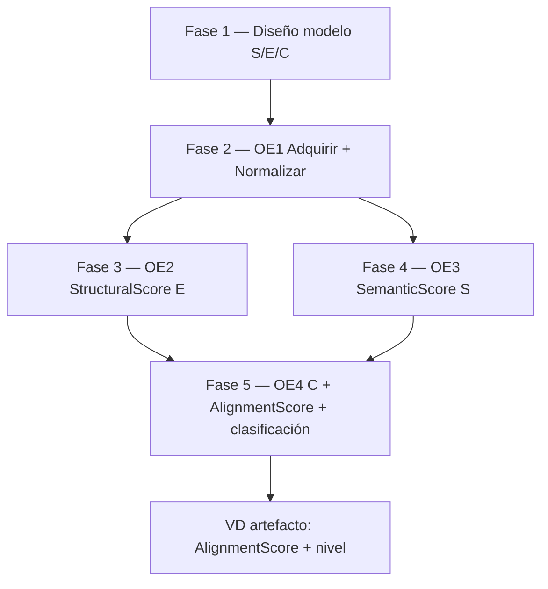

# Guía para exponer la Matriz de Consistencia (v2)

**Grupo 10** · Alex Mancilla · Jack Paitan  
**Documento de apoyo** (no es el entregable formal; complementa el Excel/PDF v2)  
**Archivos:** `Matriz_Consistencia_Grupo10_v2.xlsx` · `Matriz_Consistencia_Grupo10_v2.pdf`  
**Modelo de alineación (figuras):** `figuras_alineacion_openapi_bian.pdf`  
**Matriz v1 (10 columnas + resumen OG–OE):** `GUIA_EXPOSICION_MATRIZ_CONSISTENCIA.md`

---

## 1. ¿Qué es la v2 y cuándo usarla?

La **v2** sigue el formato **institucional de ocho columnas** (Problema → Resultados esperados). Cada **fila** es una **fase** del mismo modelo de alineación OpenAPI bancario ↔ BIAN; la **columna Objetivo General** repite el OG completo en la Fase 1 y en las demás filas indica cómo esa fase **contribuye** al OG.

| Versión | Uso recomendado en exposición |
|---------|-------------------------------|
| **v2** | Cuando el docente pide la matriz “por columnas” o alineada a la plantilla del curso |
| **v1** | Cuando conviene enfatizar VI/VD/métricas por fase y la hoja **Resumen OG–OE** |

> Mensaje clave (igual que v1): *«No medimos solo si un YAML es válido; diseñamos un procedimiento que, por cada par contrato × Service Domain BIAN, produce AlignmentScore (S, E, C) y clasificación.»*

**Producto central:** modelo con **SemanticScore (S)**, **StructuralScore (E)**, **CoverageScore (C)** →  
**AlignmentScore = α·S + β·E + γ·C** (α + β + γ = 1) · clasificación Alta / Media / Baja / Nula.

**Base de medición (OG):** instancia **contrato OpenAPI bancario × extracto Service Domain BIAN**.  
**VD del artefacto:** **AlignmentScore + clasificación** (no confundir con ratios parciales OE1–OE4).

---

## 2. Cómo leer el Excel/PDF v2

| Elemento | Contenido |
|----------|-----------|
| **Hoja única** | `Matriz v2` — 5 filas de datos (Fases 1–5) |
| **Filas 1–3** | Título, subtítulo del tema, grupo |
| **Fila de encabezados** | Las 8 columnas institucionales |

### Las ocho columnas — qué decir al pasar el dedo por la fila

| Columna | Rol en la exposición |
|---------|----------------------|
| **1. Problema de estudio** | Qué **no se sabe** o qué **impide** medir en esa fase (problema tecnológico del plan, no solo el del sector §1.2). |
| **2. Objetivo general** | Fila 1: OG **completo** (diseño + base de medición + VD artefacto). Filas 2–5: enlace explícito «contribuye al OG». |
| **3. Objetivos específicos** | OE de la fase (diseño del modelo · OE1 · OE2 · OE3 · OE4). |
| **4. Hipótesis** | Afirmación **comprobable** de esa fase (qué se espera que ocurra si el diseño es válido). |
| **5. Variables** | VI, VD (artefacto vs ratio del OE), controles — sin mezclar AlignmentScore con completitud de parsing. |
| **6. Metodología** | Fase del pipeline + enfoque (Design Science, investigación tecnológica). |
| **7. Técnicas e instrumentos** | Herramientas concretas (parsing, schema matching, similitud semántica, agregación). |
| **8. Resultados esperados** | Entregable verificable de la fase. |

**Orden sugerido al exponer una fila:** Problema → OE (col. 3) → Resultado esperado (col. 8) → Hipótesis y variables (cols. 4–5) → Metodología y técnicas (cols. 6–7) → Objetivo general solo si preguntan coherencia global.

---

## 3. Cadena lógica (cinco filas = cinco fases)

**Problema tecnológico transversal:** ¿En qué medida un contrato OpenAPI bancario se alinea con un Service Domain BIAN y bajo qué tipologías hay desalineación?

**Objetivo general (una frase para memorizar):** Diseñar el modelo S/E/C y el procedimiento reproducible que calcula **AlignmentScore** y **clasificación** por instancia contrato × SD (Guía 1 = **diseño**; ejecución empírica fuerte en Tesis 2).

---

## 4. Guion por fila (v2)

### Fila 1 — Fase 1: Diseño del modelo de alineación

| Columna | Idea oral |
|---------|-----------|
| **Problema** | No hay procedimiento documentado y reproducible que cuantifique alineación y tipologías de desalineación. |
| **OG** | Leer o parafrasear el OG completo: S, E, C, fórmula, umbrales, base de medición, VD artefacto. |
| **OE** | Definir entradas, componentes, fórmula, umbrales y criterios de verificación (marco del plan). |
| **Hipótesis** | S + E + C permiten un score reproducible e interpretable. |
| **Variables** | VI: esquema y pesos; VD: definición documentada; control: ámbito bancario, OpenAPI 3.x, Guía 1. |
| **Metodología** | Investigación tecnológica / Design Science — diseño del procedimiento (Anexo C). |
| **Técnicas** | Revisión documental, modelado, matriz de consistencia, §4.2 (sin producción). |
| **Resultados** | Pipeline documentado: adquisición → normalización → S + E + C → AlignmentScore. |

**Frase corta:** «En la Fase 1 no medimos datos reales todavía; fijamos *qué* es S, E, C y *cómo* se integran.»

---

### Fila 2 — Fase 2: Adquirir y normalizar (OE1)

| Columna | Idea oral |
|---------|-----------|
| **Problema** | REST (OpenAPI) vs. vista de negocio (BIAN) no son comparables directamente; hace falta adquisición versionada. |
| **OG** | Habilitar mediciones sobre representaciones comparables. |
| **OE** | OE1 — adquirir y normalizar a modelo intermedio común. |
| **Hipótesis** | La normalización habilita el cálculo sistemático de S, E y C. |
| **Variables** | VI: esquema intermedio; **VD ratio OE1:** completitud de extracción; control: versiones fijas. |
| **Metodología** | §4.3 adquisición + normalización (paths, operations, schemas, behaviors, BO). |
| **Técnicas** | YAML/JSON versionado, parsing OpenAPI 3.x, metadatos `{fuente}_{SD}_{versión}`. |
| **Resultados** | Representaciones normalizadas listas para matching. |

**Frase corta:** «Primero **adquirimos** el contrato y el extracto BIAN; **después** los llevamos al mismo “idioma” estructural.»

---

### Fila 3 — Fase 3: Emparejar estructuras (OE2 · P1)

| Columna | Idea oral |
|---------|-----------|
| **Problema** | Desconocemos correspondencias jerárquicas endpoint/schema ↔ Behavior/Business Object (P1). |
| **OG** | Cuantificar dimensión **estructural** → **StructuralScore (E)**. |
| **OE** | OE2 — matriz de correspondencias y E ∈ [0, 1]. |
| **Hipótesis** | Schema matching refleja si la organización REST refleja el Service Domain. |
| **Variables** | VI: estrategia de matching; **VD ratio OE2:** E; control: mismo OE1, umbral fijo. |
| **Metodología** | Emparejamiento estructural sobre normalizados. |
| **Técnicas** | Schema matching (nombre, ruta, profundidad, HTTP) — **no ML supervisado**. |
| **Resultados** | Matriz de correspondencias + E. |

**Frase corta:** «**E** responde P1: ¿la estructura del API refleja el dominio BIAN?»

Figura apoyo: `figuras_alineacion_openapi_bian.pdf` **pág. 2** (StructuralScore).

---

### Fila 4 — Fase 4: Similitud semántica (OE3 · P2)

| Columna | Idea oral |
|---------|-----------|
| **Problema** | Equivalencia semántica entre términos BIAN y nombres/descripciones OpenAPI (P2). |
| **OG** | Cuantizar **SemanticScore (S)**. |
| **OE** | OE3 — S ∈ [0, 1]. |
| **Hipótesis** | Métricas semánticas discriminan alineación vs. desalineación de modelado. |
| **Variables** | VI: embeddings / ontología / híbrido; **VD ratio OE3:** S. |
| **Metodología** | Similitud sobre representaciones OE1. |
| **Técnicas** | Embeddings + coseno, léxico/ontológico o híbrido (literatura §4.4). |
| **Resultados** | Matriz de similitud + S. |

**Frase corta:** «**S** responde P2: ¿los conceptos de negocio **significan** lo mismo?»

Figura apoyo: **pág. 3** (SemanticScore).

---

### Fila 5 — Fase 5: Integrar y clasificar (OE4 · P3–P4)

| Columna | Idea oral |
|---------|-----------|
| **Problema** | Falta indicador **integrado** y escala interpretable por instancia (P3, P4). |
| **OG** | Entregar **AlignmentScore + clasificación** — **VD global del artefacto**. |
| **OE** | OE4 — C, fórmula α·S + β·E + γ·C, tipologías. |
| **Hipótesis** | La agregación ponderada es interpretable y clasificable por niveles. |
| **Variables** | VI: α, β, γ; **VD artefacto:** AlignmentScore + nivel; **VD ratio:** C; umbrales 0,80 / 0,60 / 0,40. |
| **Metodología** | Integración y clasificación; validación empírica fuerte en **Tesis 2**. |
| **Técnicas** | Agregación lineal, reglas de clasificación, Tabla 2 Cap. 1 (tipologías). |
| **Resultados** | C, AlignmentScore, Alta/Media/Baja/Nula, informe de tipologías. |

**Frase corta:** «Aquí cerramos el modelo: **cobertura (C)** + **score final** + **nivel** de alineación.»

Figura apoyo: **pág. 1** (modelo global S/E/C → AlignmentScore); **pág. 4** (Coverage, sin usar δ como cuarto término del score oficial).

---

## 5. Tabla resumen para slide o cierre

| Fila | OE | Resultado esperado (col. 8) | Pregunta guía |
|------|-----|----------------------------|---------------|
| 1 | Marco / diseño | Modelo documentado (pipeline) | ¿Qué medimos y cómo se combina? |
| 2 | OE1 | Representaciones normalizadas | ¿Cómo hacemos comparables REST y BIAN? |
| 3 | OE2 · P1 | E + matriz estructural | ¿Refleja la estructura el SD? |
| 4 | OE3 · P2 | S + matriz semántica | ¿Coinciden los conceptos? |
| 5 | OE4 · P3–P4 | C + AlignmentScore + clasificación | ¿Cuál es la alineación global? |

---

## 6. Preguntas frecuentes del docente (v2)

**¿Por qué el Objetivo General aparece en todas las columnas?**  
Es requisito de la plantilla: muestra que **cada fase contribuye al mismo OG**. En oral, no hace falta leerlo cinco veces; en Fase 1 sí conviene el OG completo.

**¿Hipótesis vs. objetivos?**  
Los **objetivos** dicen qué se hará; la **hipótesis** dice qué se **espera demostrar** en esa fase si el diseño es correcto.

**¿Variables: hay varios “VD”?**  
Sí, de forma deliberada: **VD del artefacto (OG)** = AlignmentScore + clasificación; **VD ratio por OE** = E, S, C o completitud de normalización. La v2 lo deja explícito en la columna Variables.

**¿Adquisición va antes o después de normalizar?**  
**Antes:** adquirir (§4.3) → normalizar (OE1). Así queda en la Fase 2 de la matriz.

**¿Qué es el objeto de estudio?**  
Contratos **OpenAPI bancarios** evaluados frente a **Service Domains BIAN** como referencia.

**¿Implementación en Guía 1?**  
Guía 1 = **diseño** del procedimiento y criterios; prototipo/validación empírica ampliada en **Tesis 2**.

**¿Diferencia con la matriz v1?**  
La v1 detalla más columnas operativas (métricas, estados) y trae hoja **Resumen OG–OE**. La v2 es la **misma cadena de cinco fases** con vocabulario institucional.

---

## 7. Checklist antes de exponer (v2)

- [ ] PDF o Excel v2 abierto (`Matriz_Consistencia_Grupo10_v2.pdf`)
- [ ] Saber ubicar las **8 columnas** y recorrer **una fila** de punta a punta en &lt; 2 min
- [ ] OG completo (Fila 1) y frase «VD artefacto = AlignmentScore + clasificación»
- [ ] OE1 = adquirir **y** normalizar; orden del pipeline
- [ ] S, E, C, fórmula y umbrales de clasificación
- [ ] Figura pág. 1 del PDF de alineación para Fase 5
- [ ] Opcional: v1 o hoja Resumen OG–OE si preguntan P1–P4 en detalle

---

## 8. Tiempo sugerido (exposición oral)

| Bloque | Minutos | Contenido |
|--------|---------|-----------|
| Intro | 1 | Qué es la matriz v2 + mensaje clave + producto S/E/C |
| Fila 1 | 1,5 | Diseño del modelo (OG completo) |
| Filas 2–4 | 1,5 c/u | OE1 → OE2 (E) → OE3 (S) |
| Fila 5 | 2 | OE4, VD artefacto, clasificación + figura |
| Cierre | 0,5 | Coherencia problema → resultados en las 5 filas |

**Total orientativo:** ~9–10 min solo matriz (ajustar según tiempo del curso).

---

*Documento de apoyo Grupo 10 — alineado con `Matriz_Consistencia_Grupo10_v2.xlsx`, `build_matriz_consistencia_v2.py` y el plan LaTeX post PI-16.*
